# Entrepôt de données e-commerce en Data Vault 2.0 sur Microsoft Fabric


> Chaîne décisionnelle complète déployée dans le cloud : des fichiers sources jusqu'au tableau de bord,
> en appliquant les standards **Data Vault 2.0** - historisation native, traçabilité de chaque ligne
> et chargements rejouables sans doublon.

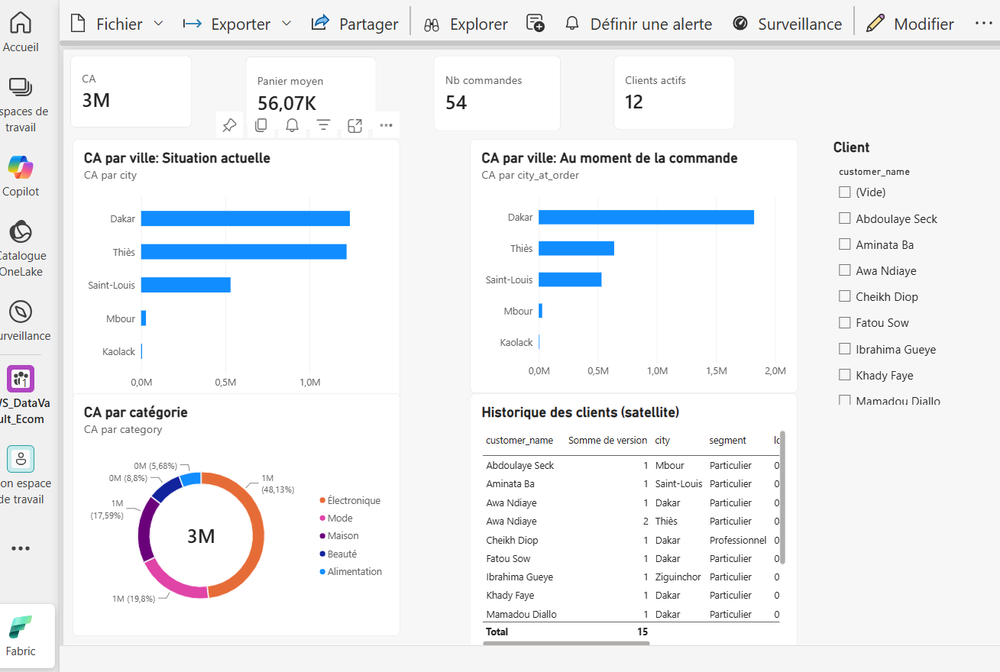

---

## Sommaire

- [Le projet en bref](#le-projet-en-bref)
- [Pourquoi Data Vault 2.0 ?](#pourquoi-data-vault-20-)
- [Architecture sur Microsoft Fabric](#architecture-sur-microsoft-fabric)
- [Modèle de données](#modèle-de-données)
- [Jeu de données](#jeu-de-données)
- [Le cœur du pipeline](#le-cœur-du-pipeline)
- [Démonstration : historisation et audit](#démonstration--historisation-et-audit)
- [Restitution Power BI](#restitution-power-bi)
- [Stack technique](#stack-technique)
- [Reproduire le projet](#reproduire-le-projet)
- [Structure du dépôt](#structure-du-dépôt)
- [Améliorations possibles](#améliorations-possibles)
- [Auteur et licence](#auteur-et-licence)

---

## Le projet en bref

**Teranga Shop** est une boutique en ligne sénégalaise fictive. Ses données proviennent de quatre systèmes
(CRM, catalogue ERP, site web, programme de fidélité) et arrivent en deux lots successifs. L'objectif :
construire un entrepôt capable d'absorber ces sources, de conserver l'intégralité de leur histoire et de
justifier l'origine de chaque chiffre publié.

Le projet couvre toute la chaîne :

- **Ingestion** des fichiers sources dans OneLake (zone d'atterrissage immuable) ;
- **Modélisation Data Vault 2.0** : 3 hubs, 2 links, 5 satellites et 1 satellite business ;
- **Chargement PySpark** entièrement *insert-only*, avec clés de hachage et détection de changement par `hashdiff` ;
- **Orchestration** par un pipeline Data Factory paramétré ;
- **Restitution** en schéma en étoile, exposé à Power BI en mode Direct Lake ;
- **Requêtes T-SQL** d'audit et de reconstitution historique.

Ce qui est démontré, preuves à l'appui :

| Propriété | Démonstration concrète |
|---|---|
| Historisation | Une cliente déménage, un prix baisse, une commande change de statut : toutes les versions sont conservées |
| Agilité | Une **nouvelle source** (fidélité) est intégrée au 2ᵉ lot sans modifier une seule table existante |
| Auditabilité | Chaque ligne porte sa source (`record_source`) et sa date de chargement (`load_date`) |
| Idempotence | Rejouer un lot à l'identique insère **0 ligne** : aucun doublon, aucune reprise manuelle |
| Impact métier | Le CA par ville varie de 582 500 FCFA selon que l'on historise ou que l'on écrase l'adresse client |

<details>
<summary><b>English summary</b></summary>

An end-to-end **Data Vault 2.0** warehouse built on **Microsoft Fabric** for a fictional e-commerce shop.
Raw CSV files land in OneLake; a parameterised PySpark notebook builds hubs, links and satellites using
MD5 hash keys and `hashdiff` change detection, with strictly insert-only loads (no UPDATE, no DELETE).
A business vault applies the revenue rule, and a star-schema information mart feeds a Power BI report in
Direct Lake mode. A Data Factory pipeline orchestrates the load, while T-SQL queries prove historisation,
auditability and idempotent reloads.

</details>

---

## Pourquoi Data Vault 2.0 ?

Les modèles classiques atteignent leurs limites quand les sources se multiplient et changent souvent :

- en **3NF**, l'arrivée d'une source impose une refonte du modèle ;
- en **étoile**, les dimensions sont souvent écrasées (SCD 1) : l'historique et la preuve d'origine disparaissent ;
- dans les deux cas, les clés de substitution séquentielles imposent des recherches de clé et un chargement
  ordonné, difficile à paralléliser.

Data Vault 2.0 sépare ce qui est **stable** (les clés métier, dans les *hubs*), ce qui est **relationnel**
(les *links*) et ce qui **change** (les *satellites*). Les clés de hachage se calculent sans consulter la base,
ce qui permet de charger toutes les tables en parallèle sur Spark.

> Data Vault ne remplace pas le modèle en étoile : il l'alimente. Ici, le vault stocke et historise,
> tandis qu'un *information mart* en étoile sert la restitution.

---

## Architecture sur Microsoft Fabric

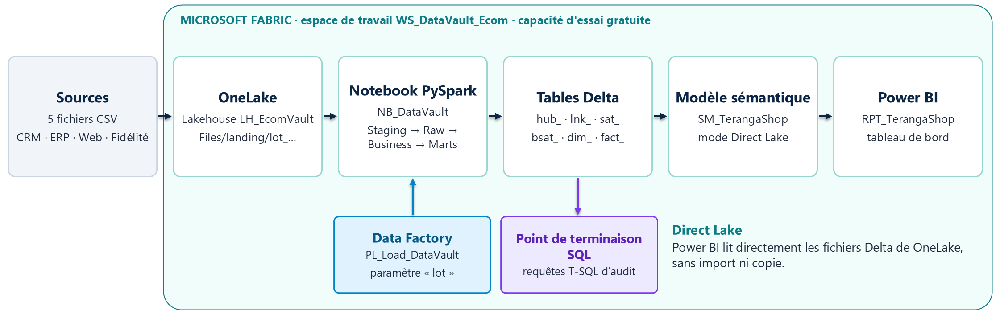

Tout est déployé dans un seul espace de travail Fabric, sur une capacité d'essai gratuite :

| Composant Fabric | Rôle dans le projet |
|---|---|
| **OneLake / Lakehouse** `LH_EcomVault` | Zone d'atterrissage `Files/landing/lot_AAAAMMJJ/` et stockage des tables au format Delta |
| **Notebook PySpark** `NB_DataVault` | Staging, Raw Vault, Business Vault, Information Mart et journal d'audit |
| **Data Factory** `PL_Load_DataVault` | Orchestration du notebook, paramétrée par le numéro de lot |
| **Point de terminaison SQL** | Requêtes T-SQL d'audit et d'historisation sur les tables Delta |
| **Power BI** `SM_TerangaShop` et `RPT_TerangaShop` | Modèle sémantique Direct Lake et rapport |

Les couches Data Vault correspondent à l'architecture médaillon d'un lakehouse :

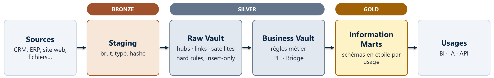

Seules les **règles techniques** (typage, hachage, colonnes d'audit) sont appliquées avant le Raw Vault.
Les **règles métier** vivent dans le Business Vault et peuvent être recalculées à tout moment, sans
recharger la moindre source.

---

## Modèle de données

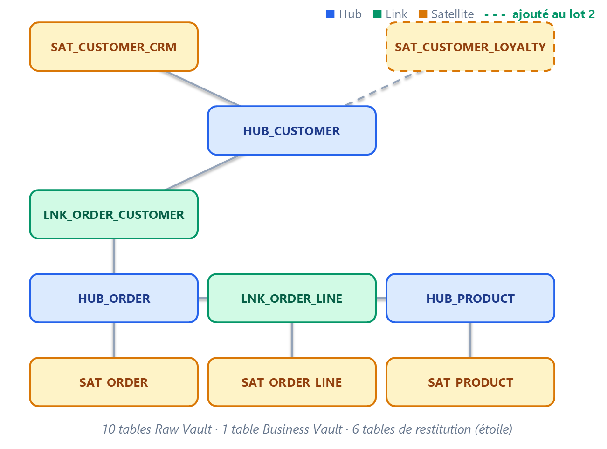

| Table | Type | Clé | Contenu |
|---|---|---|---|
| `hub_customer`, `hub_product`, `hub_order` | Hub | `hk_*` = MD5 de la clé métier | Clés métier, insérées une seule fois, jamais modifiées |
| `lnk_order_customer` | Link | `hk_order_customer` | Relation commande ↔ client |
| `lnk_order_line` | Link | `hk_order_line` (+ `line_no`) | Relation commande ↔ produit |
| `sat_customer_crm` | Satellite de hub | `hk_customer` + `load_date` | Nom, e-mail, téléphone, ville, segment |
| `sat_customer_loyalty` | Satellite de hub | `hk_customer` + `load_date` | Niveau de fidélité, points - **ajouté au lot 2** |
| `sat_product` | Satellite de hub | `hk_product` + `load_date` | Nom, catégorie, prix catalogue |
| `sat_order` | Satellite de hub | `hk_order` + `load_date` | Date, statut, canal, moyen de paiement |
| `sat_order_line` | Satellite de link | `hk_order_line` + `load_date` | Quantité, prix unitaire pratiqué |
| `bsat_order_totals` | Business Vault | `hk_order` | Montant de la commande, exclusion des commandes annulées |

Le détail des colonnes, les conventions de nommage et les six tables de restitution sont décrits dans
[docs/data-model.md](docs/data-model.md).

---

## Jeu de données

Quatre systèmes sources simulés par des fichiers CSV, livrés en deux lots pour rendre l'historisation observable.

| Fichier | Système source | Lot 1 (01/09) | Lot 2 (08/09) |
|---|---|---|---|
| `crm_customers.csv` | CRM | 12 clients | 13 clients (1 déménagement, 1 nouveau client) |
| `products.csv` | ERP (catalogue) | 15 produits | 15 produits (1 baisse de prix) |
| `orders.csv` | Site web | 40 commandes | 15 nouvelles, plus 4 changements de statut |
| `order_lines.csv` | Site web | 87 lignes | 23 lignes |
| `loyalty_members.csv` | Programme de fidélité | - | 6 membres (**nouvelle source**) |

Les fichiers sont versionnés dans [`data/landing/`](data/landing) et reproductibles avec
[`data/generate_sample_data.py`](data/generate_sample_data.py) : la graine aléatoire est fixe, le jeu de
données est donc déterministe.

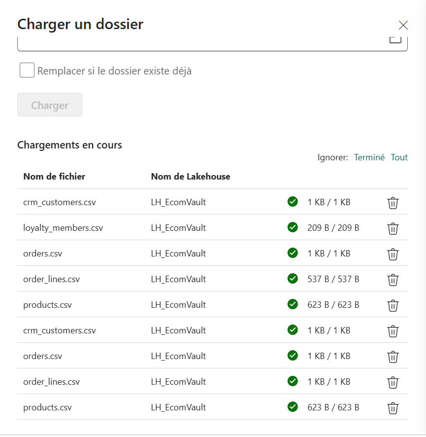

---

## Le cœur du pipeline

Trois patterns de chargement suffisent, tous strictement *insert-only*. Celui du satellite porte la logique
d'historisation : on calcule l'empreinte des attributs, on la compare à la dernière version connue, et on
n'insère que si elle a changé.

```python
def load_sat(stg, table, hk, attrs):
    """SATELLITE : on insère une nouvelle version seulement si le hashdiff diffère de la dernière version connue."""
    rows = (stg.withColumn("hashdiff", hash_diff(*attrs))
               .select(hk, "load_date", "hashdiff", "record_source", *attrs)
               .dropDuplicates([hk, "hashdiff"]))
    if table_exists(table):
        w = Window.partitionBy(hk).orderBy(F.col("load_date").desc())
        last = (spark.table(table).where(F.col("load_date") <= LOAD_DATE)
                     .withColumn("rn", F.row_number().over(w)).where("rn = 1")
                     .select(hk, F.col("hashdiff").alias("last_hashdiff")))
        rows = (rows.join(last, hk, "left")
                    .where(F.col("last_hashdiff").isNull() | (F.col("last_hashdiff") != F.col("hashdiff")))
                    .drop("last_hashdiff"))
    append(rows, table)
```

Deux empreintes structurent tout le chargement :

- **`hash_key`** = `MD5(UPPER(TRIM(clé métier)))` - la même clé est obtenue dans toutes les sources, sans
  recherche en base : hubs, links et satellites peuvent donc se charger en parallèle ;
- **`hashdiff`** = `MD5(attributs descriptifs)` - comparer une seule colonne suffit pour détecter un changement.

Le chargement du lot 1 crée les dix tables du Raw Vault :

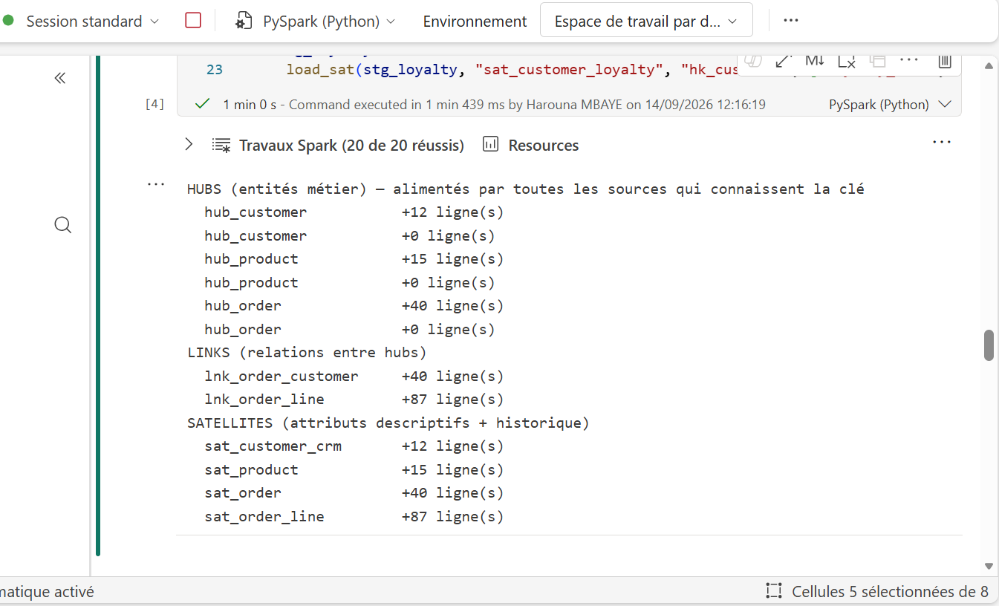

Code complet : [`fabric/notebooks/NB_DataVault.py`](fabric/notebooks/NB_DataVault.py), également fourni au
format [`NB_DataVault.ipynb`](fabric/notebooks/NB_DataVault.ipynb), directement importable dans Fabric.

---

## Démonstration : historisation et audit

Au deuxième lot, cinq événements métier se produisent. Le vault les absorbe sans jamais modifier une ligne
existante.

| Événement du lot 2 | Effet dans le vault |
|---|---|
| La cliente C003 déménage de Dakar à Thiès | `sat_customer_crm` : +1 version, l'ancienne est conservée |
| Le produit P007 passe de 25 000 à 22 500 FCFA | `sat_product` : +1 version, les ventes passées gardent leur prix |
| La commande O0039 passe de `EN_PREPARATION` à `LIVREE` | `sat_order` : +1 version, cycle de vie complet |
| Un nouveau client C013 apparaît | `hub_customer` : +1 clé |
| Le programme de fidélité est raccordé | Nouveau satellite `sat_customer_loyalty`, **0 table existante modifiée** |

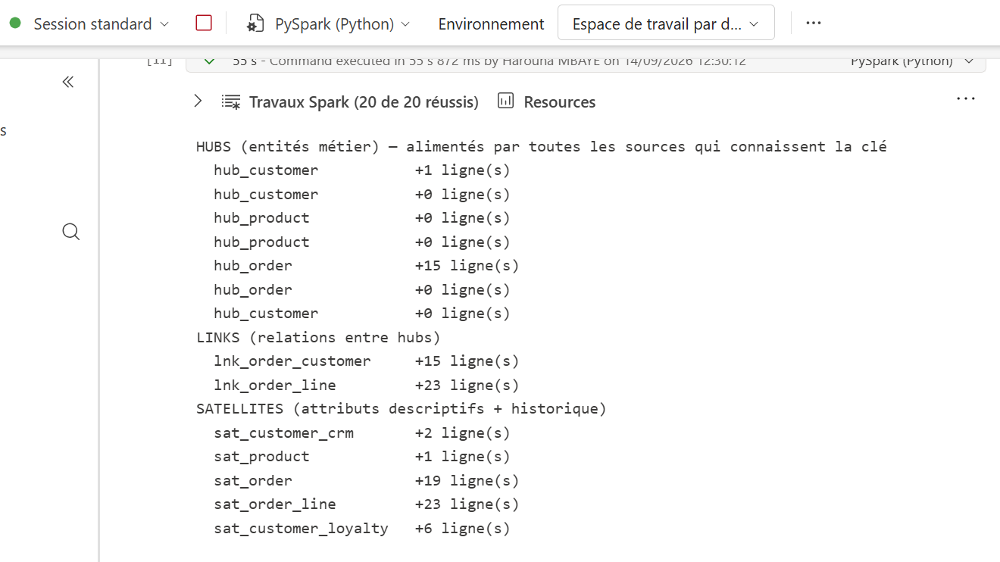

Rejouer ce même lot n'insère **aucune ligne** : le chargement est idempotent, ce qui rend les reprises sur
incident triviales.

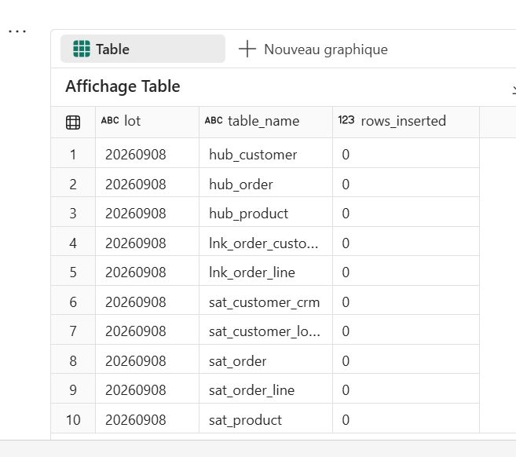

Les requêtes T-SQL ([`fabric/sql/demo_queries.sql`](fabric/sql/demo_queries.sql)) interrogent directement le
vault. Le hub ne contient qu'une fois la cliente C003, tandis que son satellite en garde deux versions,
chacune datée et sourcée :

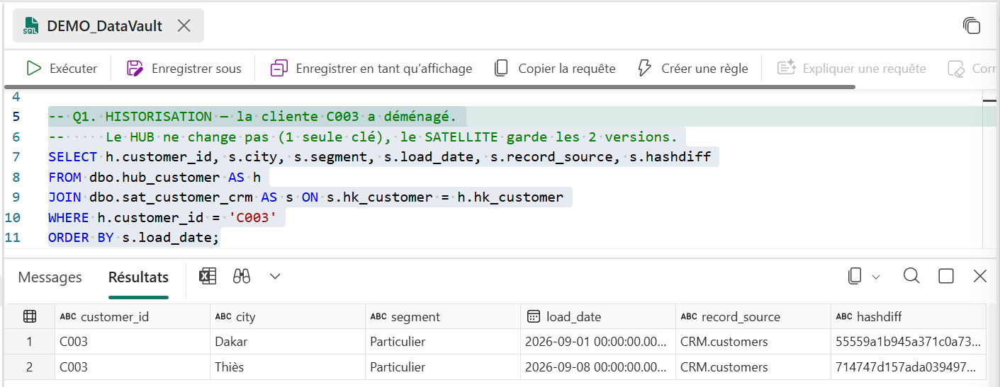

L'enjeu métier apparaît quand on agrège le chiffre d'affaires par ville :

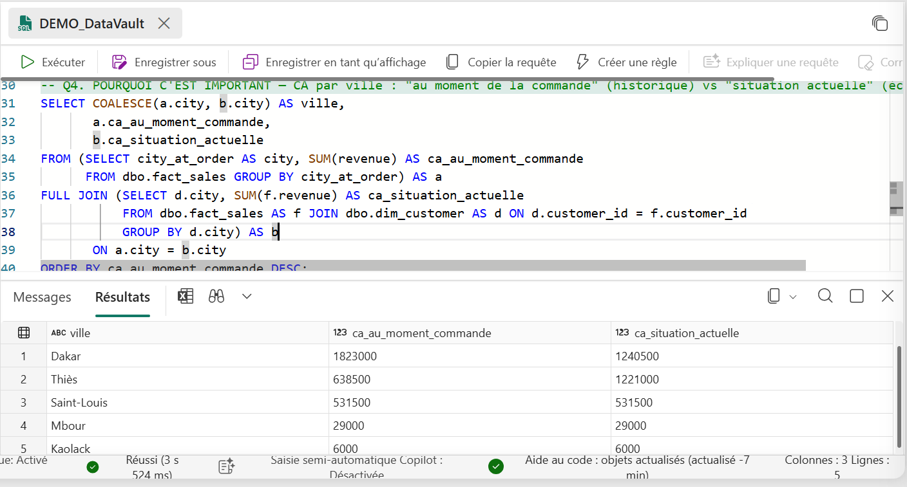

Dakar réalise **1 823 000 FCFA** si l'on attribue chaque vente à la ville du client *au moment de la commande*,
mais seulement **1 240 500 FCFA** si l'on retient son adresse *actuelle*. L'écart de 582 500 FCFA correspond
exactement au chiffre d'affaires de la cliente qui a déménagé. Un modèle qui écrase l'adresse ne saurait
produire que la seconde valeur, sans pouvoir signaler l'écart.

Enfin, chaque ligne reste traçable jusqu'à sa source et sa date d'arrivée :

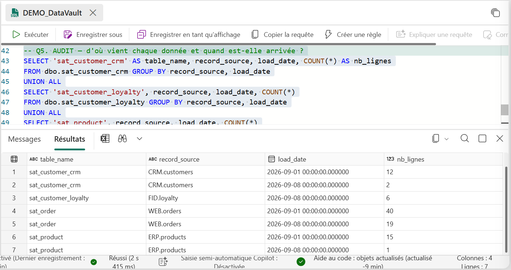

Le déroulé complet, avec les volumes attendus à chaque étape, est détaillé dans
[docs/demo-scenario.md](docs/demo-scenario.md).

---

## Restitution Power BI

Le vault n'est pas interrogé directement par les utilisateurs : un *information mart* en étoile
(`fact_sales` et ses dimensions, dont deux tables d'historique SCD 2 calculées à la lecture) est exposé à
Power BI en mode **Direct Lake**, qui lit les fichiers Delta de OneLake sans import ni copie.

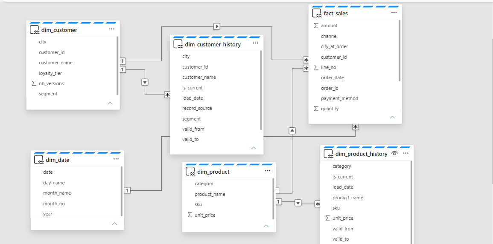

| Indicateur | Sans filtre | Filtré sur la cliente ayant déménagé |
|---|---|---|
| Chiffre d'affaires | 3 028 000 FCFA | 582 500 FCFA |
| Commandes (hors annulées) | 54 | 8 |
| Panier moyen | 56 074 FCFA | 72 813 FCFA |
| CA par ville, au moment de la commande | Dakar 1 823 000 · Thiès 638 500 | Dakar 582 500 |
| CA par ville, situation actuelle | Dakar 1 240 500 · Thiès 1 221 000 | Thiès 582 500 |

En sélectionnant cette cliente, les deux lectures apparaissent côte à côte, et son historique - issu
directement du satellite - montre ses deux versions successives :

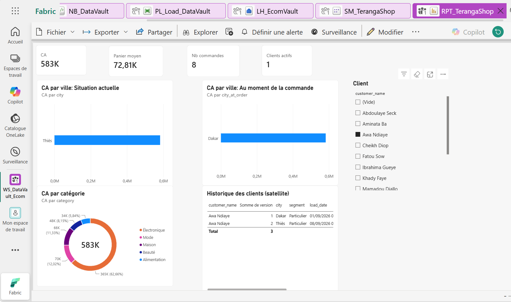

Relations et mesures DAX : [`fabric/powerbi/semantic-model.md`](fabric/powerbi/semantic-model.md).

---

## Stack technique

| Domaine | Outils et techniques |
|---|---|
| Plateforme cloud | Microsoft Fabric : OneLake, Lakehouse, Data Factory, point de terminaison SQL, Power BI |
| Traitement | PySpark (Spark 3.5), fonctions de fenêtrage, jointures anti |
| Stockage | Delta Lake (Parquet et journal transactionnel ACID) |
| Modélisation | Data Vault 2.0 : hubs, links, satellites, satellite business, information mart en étoile |
| Requêtes | T-SQL sur le point de terminaison d'analytique SQL |
| Visualisation | Power BI, modèle sémantique Direct Lake, mesures DAX |
| Données de test | Python 3, génération déterministe des deux lots |

---

## Reproduire le projet

**Prérequis** : un compte professionnel ou scolaire permettant d'activer la capacité d'essai Microsoft Fabric
(60 jours, sans carte bancaire). Python 3.10 ou plus récent uniquement si vous souhaitez régénérer les données.

1. **(Facultatif) Régénérer le jeu de données**, déjà versionné dans `data/landing/` :
   ```bash
   python data/generate_sample_data.py
   ```
2. **Créer l'espace de travail** `WS_DataVault_Ecom` (type *Essai*), puis le **Lakehouse** `LH_EcomVault`.
3. **Déposer les données** : charger le dossier `data/landing` dans la section `Files` du Lakehouse.
4. **Importer le notebook** `fabric/notebooks/NB_DataVault.ipynb`, l'attacher au Lakehouse, puis l'exécuter
   deux fois : avec `lot = "20260901"`, puis avec `lot = "20260908"`.
5. **Orchestrer** : créer le pipeline `PL_Load_DataVault` avec un paramètre `lot` de type chaîne et une
   activité Notebook recevant `@pipeline().parameters.lot` comme paramètre de base.
6. **Interroger le vault** : ouvrir le point de terminaison d'analytique SQL et exécuter
   `fabric/sql/demo_queries.sql`.
7. **Restituer** : créer un modèle sémantique Direct Lake sur `fact_sales` et les tables `dim_*`, puis
   déclarer les relations et les mesures décrites dans `fabric/powerbi/semantic-model.md`.

Le notebook étant idempotent, n'importe quel lot peut être relancé sans créer de doublon.

---

## Structure du dépôt

```text
.
├── data/
│   ├── generate_sample_data.py     # génération déterministe des deux lots
│   └── landing/
│       ├── lot_20260901/           # chargement initial
│       └── lot_20260908/           # changements et nouvelle source
├── fabric/
│   ├── notebooks/
│   │   ├── NB_DataVault.ipynb      # notebook importable dans Fabric
│   │   └── NB_DataVault.py         # même code, lisible et comparable en diff
│   ├── sql/
│   │   └── demo_queries.sql        # requêtes d'historisation et d'audit (T-SQL)
│   └── powerbi/
│       └── semantic-model.md       # relations, mesures DAX, composition du rapport
├── docs/
│   ├── data-model.md               # dictionnaire des tables et conventions
│   ├── demo-scenario.md            # scénario des deux lots et résultats attendus
│   └── images/                     # schémas et captures de la solution déployée
└── README.md
```

---

## Améliorations possibles

- **Tables PIT et Bridge** dans le Business Vault, pour accélérer les requêtes lorsque les satellites se multiplient.
- **SHA-256** à la place de MD5 pour les clés de hachage, conformément aux pratiques de production.
- **Satellites d'effectivité et multi-actifs**, pour suivre la validité des relations et les valeurs multiples.
- **Génération du code par métadonnées** (dbt avec `datavault4dbt`, ou un générateur maison), afin d'ajouter une
  source sans écrire de PySpark.
- **Tests de qualité automatisés** sur l'unicité des clés, les doublons et la fraîcheur des données.
- **CI/CD** : intégration Git native de Fabric et déploiement des éléments entre espaces de travail.
- **Ingestion réelle** : remplacer les fichiers par une capture de changements (CDC) depuis une base source.
- **Conformité RGPD** : isoler les données personnelles dans un satellite dédié, pour permettre leur
  anonymisation ciblée.

---

## Auteur et licence

**Harouna MBAYE** - conception du modèle, développement du pipeline, déploiement sur Microsoft Fabric et
restitution Power BI.

- GitHub : [@harounambaye](https://github.com/harounambaye)
- LinkedIn : [Harouna Mbaye](https://www.linkedin.com/in/harouna-mbaye-088926239/)
- Portfolio :[harouna-mbaye](https://harouna-mbaye.netlify.app/)
- Email : roonmbaye5@gmail.com

Distribué sous licence [MIT](LICENSE). Les données sont entièrement fictives et générées pour ce projet.
